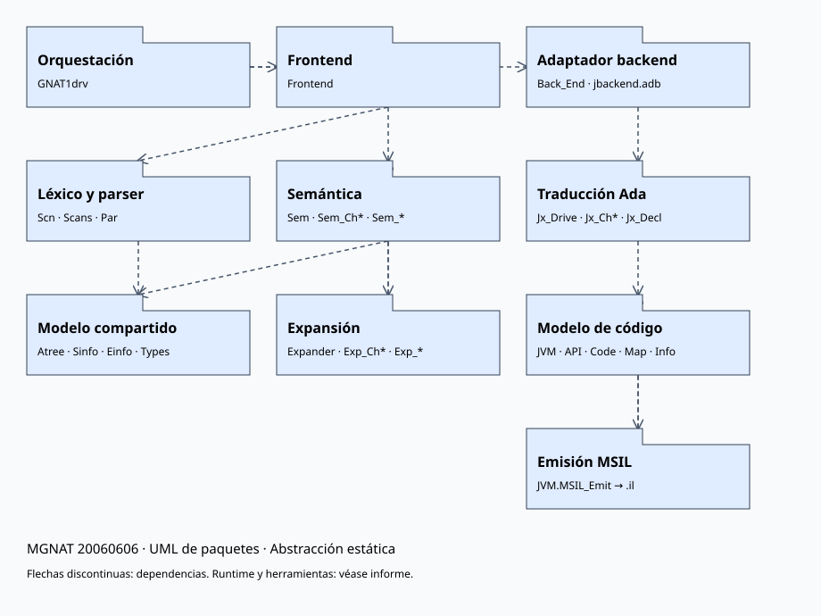

# MGNAT recuperado: UML de alto nivel

Análisis estático del archivo aportado `mgnat20060606.zip`.
SHA-256: `23572280e6d5e89bcf94f4512279d83bad5c5c3ea32306da76ca94948c77c01d`.
No se ejecutaron binarios, instaladores ni scripts del archivo. Los comentarios
se interpretan como documentación y se contrastan con código, no como instrucciones.
El archivo contiene 20 350 entradas, incluidos directorios. Se extrajo `mgnat/src`
para inspección. La fecha del nombre identifica el archivo recibido; su origen de
descarga y equivalencia con una publicación oficial aún requieren registro.

## Diagrama

La organización en grupos es una abstracción UML elaborada a partir de unidades
Ada reales. Los nombres de grupo no son namespaces existentes. Los comodines
representan familias, no paquetes únicos. Las flechas indican dependencias
seleccionadas, no un flujo completo ni una secuencia temporal. Se omiten utilidades
transversales y muchas dependencias para mantener legibilidad.

Ada organiza el compilador principalmente en paquetes y subprogramas; un diagrama
de clases C# no representa adecuadamente su arquitectura principal. Por eso esta
primera entrega utiliza paquetes con componentes internos.

## Componentes y evidencia

Rutas relativas al archivo ZIP, con líneas de las fuentes recuperadas.

| Componente | Responsabilidad observada | Evidencia |
| --- | --- | --- |
| GNAT1drv | Coordina frontend y backend | `mgnat/src/gnat1drv.adb:244`, `:620` |
| Frontend | Inicializa scanner y solicita análisis semántico | `frontend.adb:216`, `:304`; imports Par/Scn/Sem |
| Scn, Scans, Par | Léxico, tokens y análisis sintáctico | `par.adb:39`–`:43`; familias `par-*.adb` |
| Atree, Sinfo, Einfo, Types | Árbol, clases de nodos, entidades y tipos internos | imports en Frontend, Sem y Jx_Drive; especificaciones `.ads` |
| Sem y Sem_Ch* | Análisis y reglas semánticas por capítulos | `sem.adb:37`–`:50` |
| Expander y Exp_Ch* | Expansión y transformación del árbol | `expander.adb:30`–`:43`; dependencia recíproca Sem/Expander |
| Back_End | Entrada dependiente del destino | `Makefile:1328` selecciona `jbackend.adb`; `jbackend.adb:59` llama Jx_Drive |
| Jx_Drive y Jx_Ch* | Traducción del árbol GNAT al modelo de código | `jx_drive.adb:29`–`:43`; `jx_decl.ads:29`–`:32` |
| JVM y sus hijos | Modelo de clases, métodos, instrucciones y mapeos | `jvm.ads`, `jvm-code.ads`, `jvm-map.ads` |
| JVM.MSIL_Emit | Emite archivos `.il` | `jvm.adb:399`; `jvm-msil_emit.adb:1451`, `:1472` |

El nombre JVM es heredado de JGNAT. `jvm.adb:398` conserva comentada la llamada
JVM.Emit y en la línea 399 usa JVM.MSIL_Emit. La presencia de JVM.Emit y utilidades
JVM en el archivo no implica que sean la ruta activa de salida .NET.

## Runtime y herramientas alrededor del compilador

- `src/lib`: biblioteca Ada y soporte C#, incluidos `GNAT_libc`, `ada_wrapper`,
  `MonitorEx`, excepciones y conversiones; dispone de `jMakefile`.
- `include` e `include_compact`: especificaciones de interoperabilidad y artefactos
  asociados. No se representan sus miles de unidades en el diagrama principal.
- `dll` y `dll_compact`: ensamblados históricos ya construidos; su presencia no
  valida una reconstrucción actual.
- GNATmake, GNATbind y GNATlink: herramientas de construcción, enlace y elaboración
  presentes como fuentes y binarios; requieren diagramas separados para sus relaciones.
- `tests`: fuentes y resultados/binarios históricos; ninguna prueba fue ejecutada.

El runtime es consumido por programas generados y aporta soporte al backend;
se mantiene fuera del grafo principal de imports para no confundir dependencias
estáticas del compilador con dependencias de ejecución del programa.

## Archivos de esta entrega

- `paquetes-principales.puml`: UML editable en PlantUML.
- `paquetes-principales.svg`: vista gráfica de la misma abstracción principal.
- `dependencias-observadas.csv`: 3 684 cláusulas `with` detectadas en fuentes
  `.ads` y `.adb` directamente bajo `src`, con archivo y línea.
- `inventario-resumen.json`: cantidad de archivos por directorio principal.

La extracción de dependencias usa coincidencias textuales; no sustituye un parser
Ada. Excluye backups y fuentes del runtime anidadas; no captura llamadas, `use`,
subunidades, dependencias implícitas o selección condicional de build. La selección
Makefile de Back_End se revisó aparte. No se presupone que este archivo pueda
compilarse íntegramente con herramientas actuales.

## Siguiente etapa propuesta

Profundizar primero en `Par`, `Scn`, `Scans`, `Sinfo` y `Atree`: inventariar
subunidades del parser, operaciones públicas, tokens y tipos de nodos; producir
un UML de ese subsistema y una matriz regla Ada → rutina de parsing → nodo AST.
Después abordar Sem/Expander y finalmente Jx/JVM/MSIL_Emit. Las reglas de sintaxis
abstracta se derivarán de las especificaciones y constructores, distinguiendo
gramática concreta, estructura AST y restricciones semánticas.

Esta entrega inicia la ingeniería inversa solicitada. La recuperación local del
archivo está demostrada; licencias por componente, importación al repositorio y
bootstrap reproducible siguen siendo hitos independientes pendientes.
